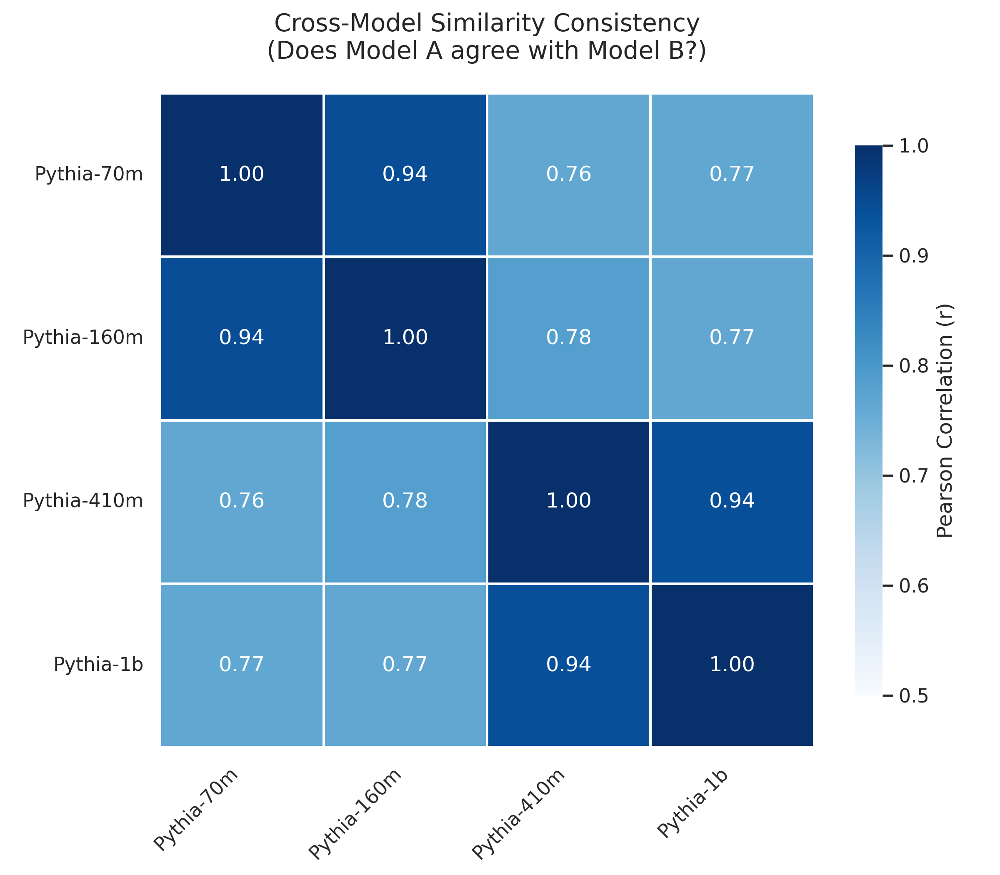
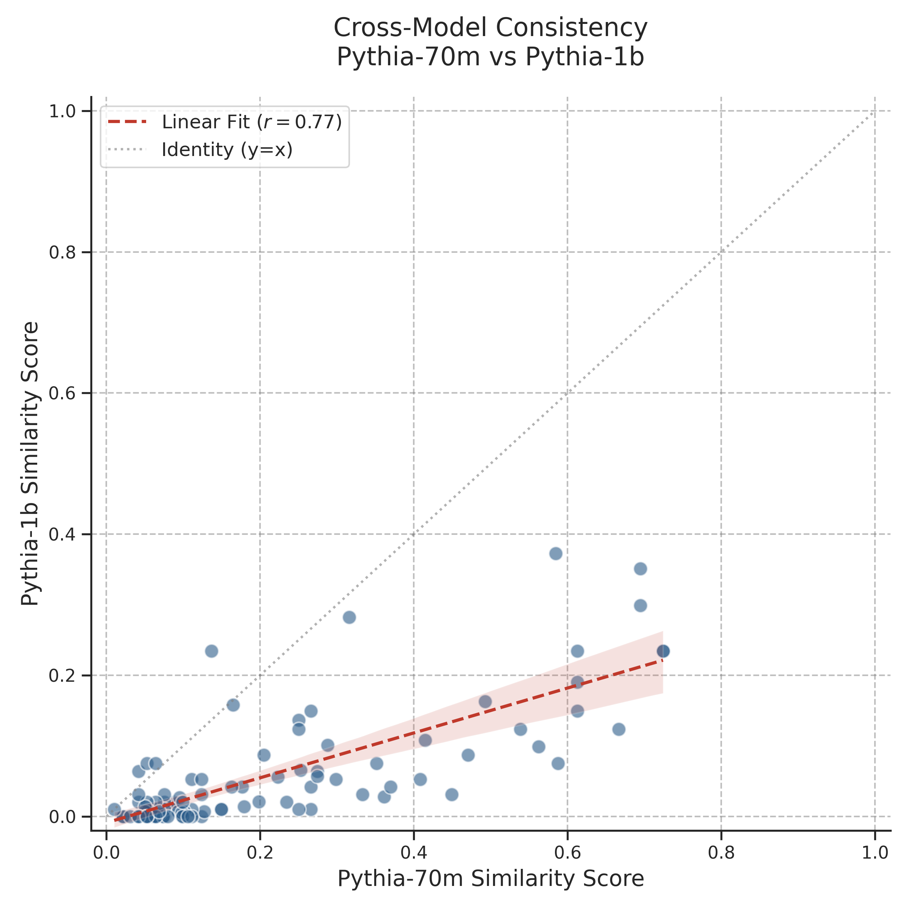
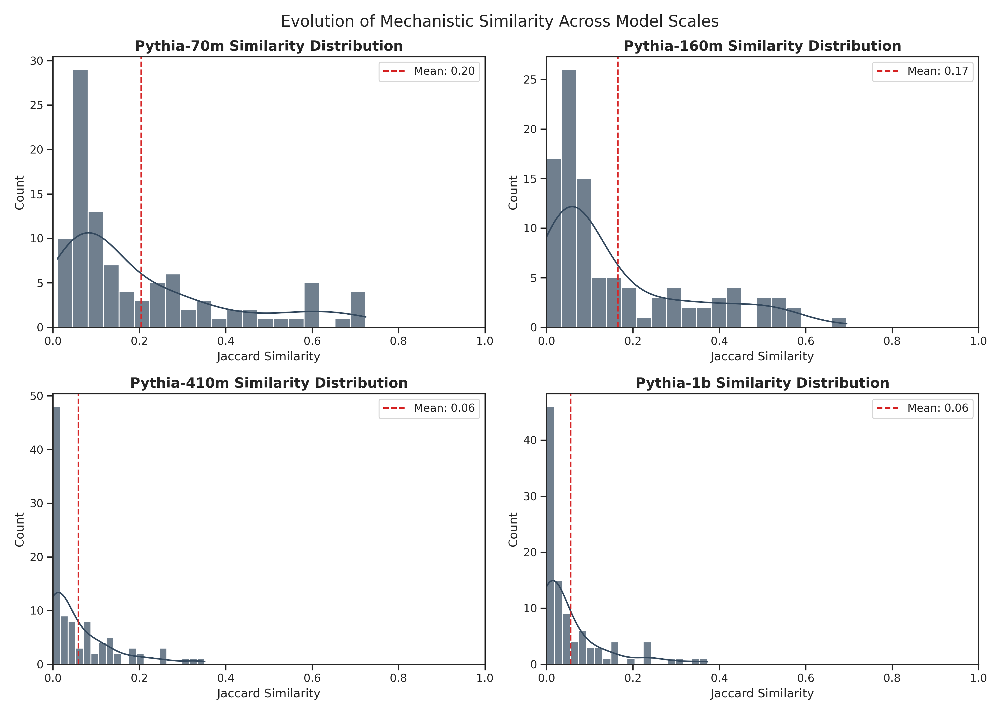

# Appendix: Universality of Mechanistic Similarity Across Model Scales

## 1. Motivation

In our primary analysis, we utilized the **Pythia-160m** model to compute the Neuron Jaccard Similarity between fact pairs. A critical question raised regarding the validity of this metric is: **Is the observed similarity structure specific to the chosen model architecture (a model-specific artifact), or does it reflect a universal property of the knowledge itself (world-shared)?**

To address this, we extended our mechanistic analysis across the Pythia model suite, ranging from **70M** to **1B** parameters. We maintained the same Gradient-Free FiNE calculation method to ensure comparability across different architectures.

## 2. Cross-Model Consistency

We first investigated whether different models share a consistent view of which fact pairs are mechanistically similar.

*__Figure A.1: Cross-Model Consistency Matrix.__ The heatmap displays Pearson correlation coefficients ($r$) of Jaccard similarity scores across four model sizes. The consistently high values ($r > 0.75$) indicate a stable topological structure of knowledge.*

As illustrated in **Figure A.1**, we observe strong positive correlations across all model scales. The similarity ranking in the 70M model is highly predictive of the ranking in the 1B model. This suggests that mechanistic similarity is **robust to model initialization and size**, capturing intrinsic relationships between facts rather than random artifacts.

## 3. Correlation and Sparsification (70M vs 1B)

To further analyze the scaling behavior, we directly compared the smallest (70M) and largest (1B) models.

*__Figure A.2: Similarity Correlation (Pythia-70m vs. Pythia-1b).__ Each point represents a fact pair. The strong linear alignment confirms shared knowledge structure. Note that most points lie below the identity line ($y=x$), indicating lower similarity scores in the larger model.*

**Figure A.2** reveals two key insights:
1.  **Linear Correlation:** The clear linear trend confirms the "World-Shared" hypothesis.
2.  **Sparsification Effect:** Most data points fall **below the diagonal** ($y=x$). This indicates that for the same fact pair, the larger model (1B) consistently assigns a **lower similarity score** than the smaller model (70M). This suggests that the larger model is more "strict" or "precise" in its neural activation overlaps.

## 4. Reduction of Polysemantic Noise

To explain why larger models assign lower scores, we visualized the distribution of similarity scores across all four models.

*__Figure A.3: Evolution of Mechanistic Similarity Distribution.__ As models scale from 70M to 1B, the distribution shifts drastically towards zero. The 1B model exhibits a significant "zero-inflation," effectively filtering out unrelated pairs.*

**Figure A.3** provides the mechanistic explanation for the sparsification observed in Figure A.2:

* **Small Models (70M):** The distribution is spread out with a "heavy tail." Due to limited capacity, **polysemantic neurons** are forced to encode multiple unrelated concepts, causing accidental overlaps (non-zero similarity for unrelated facts).
* **Large Models (1B):** The distribution becomes highly polarized, with a massive spike at 0.0. The increased capacity allows for **specialized neurons**, enabling the model to completely disentangle unrelated concepts (similarity $\rightarrow$ 0).

## 5. Conclusion

Our multi-model analysis demonstrates that the Mechanistic Similarity metric is scientifically valid. It is **universally consistent** across architectures (as shown in Figure A.1 and A.2) while reflecting the expected **scaling law of disentanglement** (Figure A.3), where larger models reduce polysemantic noise and provide a cleaner representation of knowledge structure.