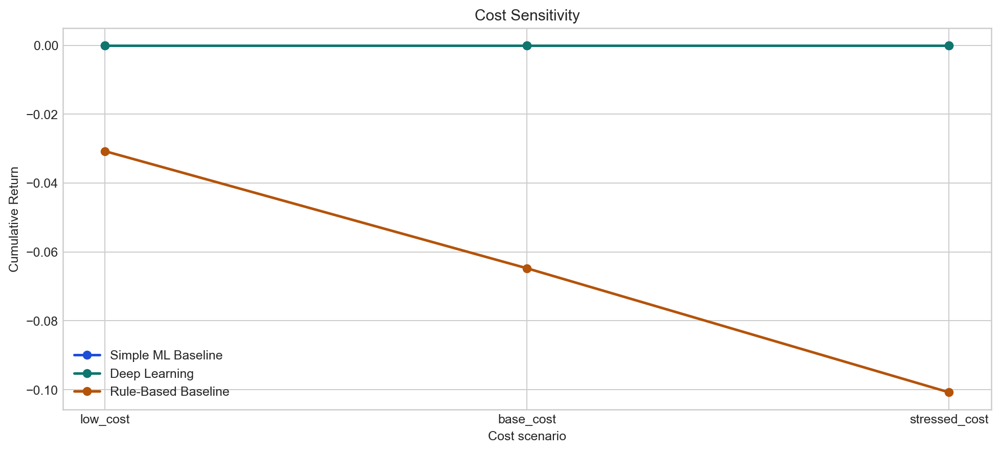
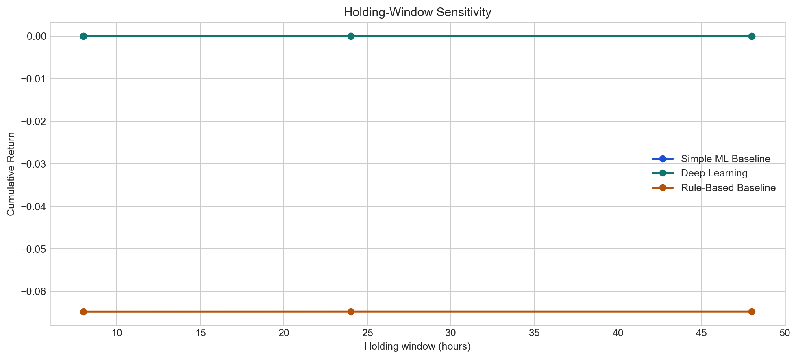
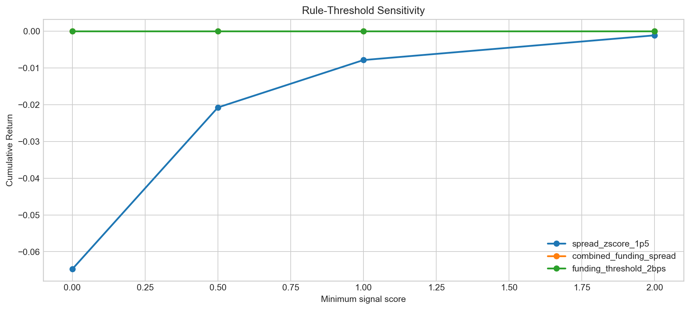
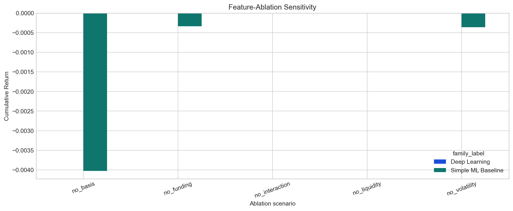

# Robustness Report

## Overview

- Symbol: `BTCUSDT`
- Provider: `binance`
- Venue: `binance`
- Frequency: `1h`
- Evaluation split(s): `['test']`
- Primary backtest split: `test`
- Ranking metric: `cumulative_return`
- Best family under the base test-period configuration: `Simple ML Baseline`

## Method Notes

- Cost and holding-window sweeps reuse the same standardized signals and the same backtest engine, so the accounting logic stays identical to the main strategy evaluation.
- Scenario leaderboards use the upgraded backtest contract: primary metrics come from mark-to-market equity on the configured primary split, and no-trade strategies are not allowed to outrank traded strategies merely because their return is zero.
- Rule-threshold sensitivity is implemented by tightening or relaxing `min_signal_score` in the standardized rule-based signal layer. This measures robustness to stronger or weaker entry confidence, not a full redefinition of the raw heuristic itself.
- Feature ablation retrains only predictive baselines and the deep-learning model, regenerates their signals, and reruns the same backtest logic. Rule-based heuristics are excluded from ablation because they do not consume the engineered feature matrix.
- The comparison tables preserve model-family metadata such as `source_subtype`, `prediction_mode`, `calibration_method`, `signal_threshold`, `threshold_objective`, checkpoint-selection fields, and loss/preprocessing settings, so upgraded baseline and deep-learning runs can be compared without collapsing everything into one generic ML bucket.

## Family Comparison

| experiment        | family_name   | family_label        | family_source_name   | scenario_name   |   scenario_order | run_name                             | strategy_name          | source      | source_subtype   | task           | evaluation_split   | status              | diagnostic_reason                         | skip_reason                               |   signal_threshold | signal_threshold_mode   | threshold_objective   | selected_threshold_objective_value   | prediction_mode   | calibration_method   | feature_importance_method   | selected_hyperparameters_json                                                                                                                                                                                                                                                                    | checkpoint_selection_metric      | best_checkpoint_metric_value   | checkpoint_selection_effective_metric   |   best_checkpoint_effective_metric_value | checkpoint_selection_fallback_used   | selected_loss   | regression_loss   | use_balanced_classification_loss   | preprocessing_scaler   |   winsorize_lower_quantile |   winsorize_upper_quantile | signal_count_by_split   |   trade_count |   active_position_count |   cumulative_return |   realized_cumulative_return |   annualized_return |   realized_annualized_return |   sharpe_ratio |   simple_annualized_sharpe |   raw_period_sharpe |   autocorr_adjusted_sharpe |   realized_sharpe_ratio |   max_drawdown |   realized_max_drawdown |   mark_to_market_max_drawdown |   win_rate |   profit_factor |   average_trade_return_bps |   median_trade_return_bps |   average_trade_pnl_usd |   expectancy_per_trade_usd |   expectancy_per_trade_bps |   average_holding_hours |   median_holding_hours |   max_consecutive_losses |   exposure_time_fraction |   average_gross_leverage |   max_gross_leverage |   total_turnover_usd |   total_fees_usd |   total_gas_cost_usd |   total_other_friction_usd |   total_embedded_slippage_cost_usd |   total_funding_pnl_usd |   funding_contribution_share |   total_gross_pnl_usd |   total_net_pnl_usd |   final_equity_usd |   realized_final_equity_usd | has_trades   | strategy_detail_label                                                                        | scenario_label   |
|:------------------|:--------------|:--------------------|:---------------------|:----------------|-----------------:|:-------------------------------------|:-----------------------|:------------|:-----------------|:---------------|:-------------------|:--------------------|:------------------------------------------|:------------------------------------------|-------------------:|:------------------------|:----------------------|:-------------------------------------|:------------------|:---------------------|:----------------------------|:-------------------------------------------------------------------------------------------------------------------------------------------------------------------------------------------------------------------------------------------------------------------------------------------------|:---------------------------------|:-------------------------------|:----------------------------------------|-----------------------------------------:|:-------------------------------------|:----------------|:------------------|:-----------------------------------|:-----------------------|---------------------------:|---------------------------:|:------------------------|--------------:|------------------------:|--------------------:|-----------------------------:|--------------------:|-----------------------------:|---------------:|---------------------------:|--------------------:|---------------------------:|------------------------:|---------------:|------------------------:|------------------------------:|-----------:|----------------:|---------------------------:|--------------------------:|------------------------:|---------------------------:|---------------------------:|------------------------:|-----------------------:|-------------------------:|-------------------------:|-------------------------:|---------------------:|---------------------:|-----------------:|---------------------:|---------------------------:|-----------------------------------:|------------------------:|-----------------------------:|----------------------:|--------------------:|-------------------:|----------------------------:|:-------------|:---------------------------------------------------------------------------------------------|:-----------------|
| family_comparison | baseline_ml   | Simple ML Baseline  | baseline-ml          | base            |                1 | family_comparison_baseline_ml_base   | elastic_net_regression | baseline-ml | baseline_linear  | regression     | test               | no_tradable_signals | test: signal_count == 0 for split 'test'. | test: signal_count == 0 for split 'test'. |                  0 | constant                | avg_signal_return_bps |                                      | static            | none                 | permutation_validation      | {"alpha": 1.0, "estimator": "elastic_net", "l1_ratio": 0.2, "random_state": 42}                                                                                                                                                                                                                  |                                  |                                |                                         |                               nan        | False                                |                 |                   | False                              |                        |                     nan    |                     nan    | {"test": 0}             |             0 |                       0 |            0        |                     0        |            0        |                     0        |       nan      |                   nan      |          nan        |                   nan      |                nan      |     nan        |              nan        |                    nan        |        nan |             nan |                   nan      |                  nan      |                nan      |                   nan      |                   nan      |                 nan     |                    nan |                        0 |                 0        |                 0        |                  0   |                0     |                0 |                    0 |                          0 |                                  0 |                  0      |                     0        |                  0    |                0    |           100000   |                    100000   | False        | baseline_linear | static | thr=0                                                             | base             |
| family_comparison | deep_learning | Deep Learning       | dl                   | base            |                1 | family_comparison_deep_learning_base | transformer_encoder    | dl          | deep_learning    | regression     | test               | no_tradable_signals | test: signal_count == 0 for split 'test'. | test: signal_count == 0 for split 'test'. |                  0 | constant                | avg_signal_return_bps |                                      | static            | none                 | ablation_validation         | {"batch_size": 256, "dropout": 0.1, "learning_rate": 0.001, "lookback_steps": 48, "model_name": "transformer_encoder", "transformer_d_model": 64, "transformer_dim_feedforward": 128, "transformer_nhead": 4, "transformer_num_layers": 2, "transformer_pooling": "last", "weight_decay": 1e-05} | validation_avg_signal_return_bps |                                | validation_loss                         |                                 0.948847 | True                                 | huber           | huber             | False                              | robust                 |                       0.01 |                       0.99 | {"test": 0}             |             0 |                       0 |            0        |                     0        |            0        |                     0        |       nan      |                   nan      |          nan        |                   nan      |                nan      |     nan        |              nan        |                    nan        |        nan |             nan |                   nan      |                  nan      |                nan      |                   nan      |                   nan      |                 nan     |                    nan |                        0 |                 0        |                 0        |                  0   |                0     |                0 |                    0 |                          0 |                                  0 |                  0      |                     0        |                  0    |                0    |           100000   |                    100000   | False        | deep_learning | static | thr=0 | loss=huber | ckpt=validation_loss | scale=robust | fallback | base             |
| family_comparison | rule_based    | Rule-Based Baseline | rules                | base            |                1 | family_comparison_rule_based_base    | spread_zscore_1p5      | rules       | rule_based       | classification | test               | completed           |                                           |                                           |                  2 | constant                | avg_signal_return_bps |                                      | static            | none                 | not_applicable              | {}                                                                                                                                                                                                                                                                                               |                                  |                                |                                         |                               nan        | False                                |                 |                   | False                              |                        |                     nan    |                     nan    | {"test": 237}           |           200 |                     200 |           -0.064749 |                    -0.064749 |           -0.063419 |                    -0.063419 |       -14.0721 |                   -14.0721 |           -0.150351 |                   -12.9124 |                -14.1376 |      -0.064749 |               -0.064749 |                     -0.064749 |          0 |               0 |                   -32.3743 |                  -32.5641 |                -32.3743 |                   -32.3743 |                   -32.3743 |                   1.185 |                      1 |                      200 |                 0.026477 |                 0.005295 |                  0.2 |                8e+06 |             4000 |                  400 |                          0 |                               2400 |                  7.9136 |                     0.001222 |              -2074.85 |            -6474.85 |            93525.1 |                     93525.1 | True         | rule_based | static | thr=2                                                                  | base             |

## Cost Sensitivity

| experiment       | family_name   | family_label        | family_source_name   | scenario_name   |   scenario_order | run_name                                     | strategy_name          | source      | source_subtype   | task           | evaluation_split   | status              | diagnostic_reason                         | skip_reason                               |   signal_threshold | signal_threshold_mode   | threshold_objective   | selected_threshold_objective_value   | prediction_mode   | calibration_method   | feature_importance_method   | selected_hyperparameters_json                                                                                                                                                                                                                                                                    | checkpoint_selection_metric      | best_checkpoint_metric_value   | checkpoint_selection_effective_metric   |   best_checkpoint_effective_metric_value | checkpoint_selection_fallback_used   | selected_loss   | regression_loss   | use_balanced_classification_loss   | preprocessing_scaler   |   winsorize_lower_quantile |   winsorize_upper_quantile | signal_count_by_split   |   trade_count |   active_position_count |   cumulative_return |   realized_cumulative_return |   annualized_return |   realized_annualized_return |   sharpe_ratio |   simple_annualized_sharpe |   raw_period_sharpe |   autocorr_adjusted_sharpe |   realized_sharpe_ratio |   max_drawdown |   realized_max_drawdown |   mark_to_market_max_drawdown |   win_rate |   profit_factor |   average_trade_return_bps |   median_trade_return_bps |   average_trade_pnl_usd |   expectancy_per_trade_usd |   expectancy_per_trade_bps |   average_holding_hours |   median_holding_hours |   max_consecutive_losses |   exposure_time_fraction |   average_gross_leverage |   max_gross_leverage |   total_turnover_usd |   total_fees_usd |   total_gas_cost_usd |   total_other_friction_usd |   total_embedded_slippage_cost_usd |   total_funding_pnl_usd |   funding_contribution_share |   total_gross_pnl_usd |   total_net_pnl_usd |   final_equity_usd |   realized_final_equity_usd | has_trades   | strategy_detail_label                                                                        | name          |   taker_fee_bps |   slippage_bps |   gas_cost_usd |   other_friction_bps |
|:-----------------|:--------------|:--------------------|:---------------------|:----------------|-----------------:|:---------------------------------------------|:-----------------------|:------------|:-----------------|:---------------|:-------------------|:--------------------|:------------------------------------------|:------------------------------------------|-------------------:|:------------------------|:----------------------|:-------------------------------------|:------------------|:---------------------|:----------------------------|:-------------------------------------------------------------------------------------------------------------------------------------------------------------------------------------------------------------------------------------------------------------------------------------------------|:---------------------------------|:-------------------------------|:----------------------------------------|-----------------------------------------:|:-------------------------------------|:----------------|:------------------|:-----------------------------------|:-----------------------|---------------------------:|---------------------------:|:------------------------|--------------:|------------------------:|--------------------:|-----------------------------:|--------------------:|-----------------------------:|---------------:|---------------------------:|--------------------:|---------------------------:|------------------------:|---------------:|------------------------:|------------------------------:|-----------:|----------------:|---------------------------:|--------------------------:|------------------------:|---------------------------:|---------------------------:|------------------------:|-----------------------:|-------------------------:|-------------------------:|-------------------------:|---------------------:|---------------------:|-----------------:|---------------------:|---------------------------:|-----------------------------------:|------------------------:|-----------------------------:|----------------------:|--------------------:|-------------------:|----------------------------:|:-------------|:---------------------------------------------------------------------------------------------|:--------------|----------------:|---------------:|---------------:|---------------------:|
| cost_sensitivity | baseline_ml   | Simple ML Baseline  | baseline-ml          | base_cost       |                2 | cost_sensitivity_baseline_ml_base_cost       | elastic_net_regression | baseline-ml | baseline_linear  | regression     | test               | no_tradable_signals | test: signal_count == 0 for split 'test'. | test: signal_count == 0 for split 'test'. |                  0 | constant                | avg_signal_return_bps |                                      | static            | none                 | permutation_validation      | {"alpha": 1.0, "estimator": "elastic_net", "l1_ratio": 0.2, "random_state": 42}                                                                                                                                                                                                                  |                                  |                                |                                         |                               nan        | False                                |                 |                   | False                              |                        |                     nan    |                     nan    | {"test": 0}             |             0 |                       0 |            0        |                     0        |            0        |                     0        |       nan      |                   nan      |          nan        |                   nan      |                nan      |     nan        |              nan        |                    nan        |        nan |             nan |                   nan      |                  nan      |                nan      |                   nan      |                   nan      |                 nan     |                    nan |                        0 |                 0        |                 0        |                  0   |                0     |                0 |                    0 |                          0 |                                  0 |                  0      |                     0        |                 0     |                0    |           100000   |                    100000   | False        | baseline_linear | static | thr=0                                                             | base_cost     |               5 |              3 |              2 |                    0 |
| cost_sensitivity | baseline_ml   | Simple ML Baseline  | baseline-ml          | low_cost        |                1 | cost_sensitivity_baseline_ml_low_cost        | elastic_net_regression | baseline-ml | baseline_linear  | regression     | test               | no_tradable_signals | test: signal_count == 0 for split 'test'. | test: signal_count == 0 for split 'test'. |                  0 | constant                | avg_signal_return_bps |                                      | static            | none                 | permutation_validation      | {"alpha": 1.0, "estimator": "elastic_net", "l1_ratio": 0.2, "random_state": 42}                                                                                                                                                                                                                  |                                  |                                |                                         |                               nan        | False                                |                 |                   | False                              |                        |                     nan    |                     nan    | {"test": 0}             |             0 |                       0 |            0        |                     0        |            0        |                     0        |       nan      |                   nan      |          nan        |                   nan      |                nan      |     nan        |              nan        |                    nan        |        nan |             nan |                   nan      |                  nan      |                nan      |                   nan      |                   nan      |                 nan     |                    nan |                        0 |                 0        |                 0        |                  0   |                0     |                0 |                    0 |                          0 |                                  0 |                  0      |                     0        |                 0     |                0    |           100000   |                    100000   | False        | baseline_linear | static | thr=0                                                             | low_cost      |               3 |              1 |              1 |                    0 |
| cost_sensitivity | baseline_ml   | Simple ML Baseline  | baseline-ml          | stressed_cost   |                3 | cost_sensitivity_baseline_ml_stressed_cost   | elastic_net_regression | baseline-ml | baseline_linear  | regression     | test               | no_tradable_signals | test: signal_count == 0 for split 'test'. | test: signal_count == 0 for split 'test'. |                  0 | constant                | avg_signal_return_bps |                                      | static            | none                 | permutation_validation      | {"alpha": 1.0, "estimator": "elastic_net", "l1_ratio": 0.2, "random_state": 42}                                                                                                                                                                                                                  |                                  |                                |                                         |                               nan        | False                                |                 |                   | False                              |                        |                     nan    |                     nan    | {"test": 0}             |             0 |                       0 |            0        |                     0        |            0        |                     0        |       nan      |                   nan      |          nan        |                   nan      |                nan      |     nan        |              nan        |                    nan        |        nan |             nan |                   nan      |                  nan      |                nan      |                   nan      |                   nan      |                 nan     |                    nan |                        0 |                 0        |                 0        |                  0   |                0     |                0 |                    0 |                          0 |                                  0 |                  0      |                     0        |                 0     |                0    |           100000   |                    100000   | False        | baseline_linear | static | thr=0                                                             | stressed_cost |               7 |              5 |              3 |                    1 |
| cost_sensitivity | deep_learning | Deep Learning       | dl                   | base_cost       |                2 | cost_sensitivity_deep_learning_base_cost     | transformer_encoder    | dl          | deep_learning    | regression     | test               | no_tradable_signals | test: signal_count == 0 for split 'test'. | test: signal_count == 0 for split 'test'. |                  0 | constant                | avg_signal_return_bps |                                      | static            | none                 | ablation_validation         | {"batch_size": 256, "dropout": 0.1, "learning_rate": 0.001, "lookback_steps": 48, "model_name": "transformer_encoder", "transformer_d_model": 64, "transformer_dim_feedforward": 128, "transformer_nhead": 4, "transformer_num_layers": 2, "transformer_pooling": "last", "weight_decay": 1e-05} | validation_avg_signal_return_bps |                                | validation_loss                         |                                 0.948847 | True                                 | huber           | huber             | False                              | robust                 |                       0.01 |                       0.99 | {"test": 0}             |             0 |                       0 |            0        |                     0        |            0        |                     0        |       nan      |                   nan      |          nan        |                   nan      |                nan      |     nan        |              nan        |                    nan        |        nan |             nan |                   nan      |                  nan      |                nan      |                   nan      |                   nan      |                 nan     |                    nan |                        0 |                 0        |                 0        |                  0   |                0     |                0 |                    0 |                          0 |                                  0 |                  0      |                     0        |                 0     |                0    |           100000   |                    100000   | False        | deep_learning | static | thr=0 | loss=huber | ckpt=validation_loss | scale=robust | fallback | base_cost     |               5 |              3 |              2 |                    0 |
| cost_sensitivity | deep_learning | Deep Learning       | dl                   | low_cost        |                1 | cost_sensitivity_deep_learning_low_cost      | transformer_encoder    | dl          | deep_learning    | regression     | test               | no_tradable_signals | test: signal_count == 0 for split 'test'. | test: signal_count == 0 for split 'test'. |                  0 | constant                | avg_signal_return_bps |                                      | static            | none                 | ablation_validation         | {"batch_size": 256, "dropout": 0.1, "learning_rate": 0.001, "lookback_steps": 48, "model_name": "transformer_encoder", "transformer_d_model": 64, "transformer_dim_feedforward": 128, "transformer_nhead": 4, "transformer_num_layers": 2, "transformer_pooling": "last", "weight_decay": 1e-05} | validation_avg_signal_return_bps |                                | validation_loss                         |                                 0.948847 | True                                 | huber           | huber             | False                              | robust                 |                       0.01 |                       0.99 | {"test": 0}             |             0 |                       0 |            0        |                     0        |            0        |                     0        |       nan      |                   nan      |          nan        |                   nan      |                nan      |     nan        |              nan        |                    nan        |        nan |             nan |                   nan      |                  nan      |                nan      |                   nan      |                   nan      |                 nan     |                    nan |                        0 |                 0        |                 0        |                  0   |                0     |                0 |                    0 |                          0 |                                  0 |                  0      |                     0        |                 0     |                0    |           100000   |                    100000   | False        | deep_learning | static | thr=0 | loss=huber | ckpt=validation_loss | scale=robust | fallback | low_cost      |               3 |              1 |              1 |                    0 |
| cost_sensitivity | deep_learning | Deep Learning       | dl                   | stressed_cost   |                3 | cost_sensitivity_deep_learning_stressed_cost | transformer_encoder    | dl          | deep_learning    | regression     | test               | no_tradable_signals | test: signal_count == 0 for split 'test'. | test: signal_count == 0 for split 'test'. |                  0 | constant                | avg_signal_return_bps |                                      | static            | none                 | ablation_validation         | {"batch_size": 256, "dropout": 0.1, "learning_rate": 0.001, "lookback_steps": 48, "model_name": "transformer_encoder", "transformer_d_model": 64, "transformer_dim_feedforward": 128, "transformer_nhead": 4, "transformer_num_layers": 2, "transformer_pooling": "last", "weight_decay": 1e-05} | validation_avg_signal_return_bps |                                | validation_loss                         |                                 0.948847 | True                                 | huber           | huber             | False                              | robust                 |                       0.01 |                       0.99 | {"test": 0}             |             0 |                       0 |            0        |                     0        |            0        |                     0        |       nan      |                   nan      |          nan        |                   nan      |                nan      |     nan        |              nan        |                    nan        |        nan |             nan |                   nan      |                  nan      |                nan      |                   nan      |                   nan      |                 nan     |                    nan |                        0 |                 0        |                 0        |                  0   |                0     |                0 |                    0 |                          0 |                                  0 |                  0      |                     0        |                 0     |                0    |           100000   |                    100000   | False        | deep_learning | static | thr=0 | loss=huber | ckpt=validation_loss | scale=robust | fallback | stressed_cost |               7 |              5 |              3 |                    1 |
| cost_sensitivity | rule_based    | Rule-Based Baseline | rules                | base_cost       |                2 | cost_sensitivity_rule_based_base_cost        | spread_zscore_1p5      | rules       | rule_based       | classification | test               | completed           |                                           |                                           |                  2 | constant                | avg_signal_return_bps |                                      | static            | none                 | not_applicable              | {}                                                                                                                                                                                                                                                                                               |                                  |                                |                                         |                               nan        | False                                |                 |                   | False                              |                        |                     nan    |                     nan    | {"test": 237}           |           200 |                     200 |           -0.064749 |                    -0.064749 |           -0.063419 |                    -0.063419 |       -14.0721 |                   -14.0721 |           -0.150351 |                   -12.9124 |                -14.1376 |      -0.064749 |               -0.064749 |                     -0.064749 |          0 |               0 |                   -32.3743 |                  -32.5641 |                -32.3743 |                   -32.3743 |                   -32.3743 |                   1.185 |                      1 |                      200 |                 0.026477 |                 0.005295 |                  0.2 |                8e+06 |             4000 |                  400 |                          0 |                               2400 |                  7.9136 |                     0.001222 |             -2074.85  |            -6474.85 |            93525.1 |                     93525.1 | True         | rule_based | static | thr=2                                                                  | base_cost     |               5 |              3 |              2 |                    0 |
| cost_sensitivity | rule_based    | Rule-Based Baseline | rules                | low_cost        |                1 | cost_sensitivity_rule_based_low_cost         | spread_zscore_1p5      | rules       | rule_based       | classification | test               | completed           |                                           |                                           |                  2 | constant                | avg_signal_return_bps |                                      | static            | none                 | not_applicable              | {}                                                                                                                                                                                                                                                                                               |                                  |                                |                                         |                               nan        | False                                |                 |                   | False                              |                        |                     nan    |                     nan    | {"test": 237}           |           200 |                     200 |           -0.030743 |                    -0.030743 |           -0.0301   |                    -0.0301   |       -13.9652 |                   -13.9652 |           -0.149209 |                   -12.8522 |                -14.1102 |      -0.030743 |               -0.030743 |                     -0.030743 |          0 |               0 |                   -15.3714 |                  -15.5588 |                -15.3714 |                   -15.3714 |                   -15.3714 |                   1.185 |                      1 |                      200 |                 0.026477 |                 0.005295 |                  0.2 |                8e+06 |             2400 |                  200 |                          0 |                                800 |                  7.9136 |                     0.002574 |              -474.272 |            -3074.27 |            96925.7 |                     96925.7 | True         | rule_based | static | thr=2                                                                  | low_cost      |               3 |              1 |              1 |                    0 |
| cost_sensitivity | rule_based    | Rule-Based Baseline | rules                | stressed_cost   |                3 | cost_sensitivity_rule_based_stressed_cost    | spread_zscore_1p5      | rules       | rule_based       | classification | test               | completed           |                                           |                                           |                  2 | constant                | avg_signal_return_bps |                                      | static            | none                 | not_applicable              | {}                                                                                                                                                                                                                                                                                               |                                  |                                |                                         |                               nan        | False                                |                 |                   | False                              |                        |                     nan    |                     nan    | {"test": 237}           |           200 |                     200 |           -0.100754 |                    -0.100754 |           -0.098725 |                    -0.098725 |       -14.0973 |                   -14.0973 |           -0.15062  |                   -12.9361 |                -14.1385 |      -0.100754 |               -0.100754 |                     -0.100754 |          0 |               0 |                   -50.3772 |                  -50.5689 |                -50.3772 |                   -50.3772 |                   -50.3772 |                   1.185 |                      1 |                      200 |                 0.026477 |                 0.005295 |                  0.2 |                8e+06 |             5600 |                  600 |                        200 |                               4000 |                  7.9136 |                     0.000785 |             -3675.44  |           -10075.4  |            89924.6 |                     89924.6 | True         | rule_based | static | thr=2                                                                  | stressed_cost |               7 |              5 |              3 |                    1 |

## Holding-Window Sensitivity

| experiment                 | family_name   | family_label        | family_source_name   | scenario_name   |   scenario_order | run_name                                          | strategy_name          | source      | source_subtype   | task           | evaluation_split   | status              | diagnostic_reason                         | skip_reason                               |   signal_threshold | signal_threshold_mode   | threshold_objective   | selected_threshold_objective_value   | prediction_mode   | calibration_method   | feature_importance_method   | selected_hyperparameters_json                                                                                                                                                                                                                                                                    | checkpoint_selection_metric      | best_checkpoint_metric_value   | checkpoint_selection_effective_metric   |   best_checkpoint_effective_metric_value | checkpoint_selection_fallback_used   | selected_loss   | regression_loss   | use_balanced_classification_loss   | preprocessing_scaler   |   winsorize_lower_quantile |   winsorize_upper_quantile | signal_count_by_split   |   trade_count |   active_position_count |   cumulative_return |   realized_cumulative_return |   annualized_return |   realized_annualized_return |   sharpe_ratio |   simple_annualized_sharpe |   raw_period_sharpe |   autocorr_adjusted_sharpe |   realized_sharpe_ratio |   max_drawdown |   realized_max_drawdown |   mark_to_market_max_drawdown |   win_rate |   profit_factor |   average_trade_return_bps |   median_trade_return_bps |   average_trade_pnl_usd |   expectancy_per_trade_usd |   expectancy_per_trade_bps |   average_holding_hours |   median_holding_hours |   max_consecutive_losses |   exposure_time_fraction |   average_gross_leverage |   max_gross_leverage |   total_turnover_usd |   total_fees_usd |   total_gas_cost_usd |   total_other_friction_usd |   total_embedded_slippage_cost_usd |   total_funding_pnl_usd |   funding_contribution_share |   total_gross_pnl_usd |   total_net_pnl_usd |   final_equity_usd |   realized_final_equity_usd | has_trades   | strategy_detail_label                                                                        | name     |   holding_window_hours |   maximum_holding_hours |
|:---------------------------|:--------------|:--------------------|:---------------------|:----------------|-----------------:|:--------------------------------------------------|:-----------------------|:------------|:-----------------|:---------------|:-------------------|:--------------------|:------------------------------------------|:------------------------------------------|-------------------:|:------------------------|:----------------------|:-------------------------------------|:------------------|:---------------------|:----------------------------|:-------------------------------------------------------------------------------------------------------------------------------------------------------------------------------------------------------------------------------------------------------------------------------------------------|:---------------------------------|:-------------------------------|:----------------------------------------|-----------------------------------------:|:-------------------------------------|:----------------|:------------------|:-----------------------------------|:-----------------------|---------------------------:|---------------------------:|:------------------------|--------------:|------------------------:|--------------------:|-----------------------------:|--------------------:|-----------------------------:|---------------:|---------------------------:|--------------------:|---------------------------:|------------------------:|---------------:|------------------------:|------------------------------:|-----------:|----------------:|---------------------------:|--------------------------:|------------------------:|---------------------------:|---------------------------:|------------------------:|-----------------------:|-------------------------:|-------------------------:|-------------------------:|---------------------:|---------------------:|-----------------:|---------------------:|---------------------------:|-----------------------------------:|------------------------:|-----------------------------:|----------------------:|--------------------:|-------------------:|----------------------------:|:-------------|:---------------------------------------------------------------------------------------------|:---------|-----------------------:|------------------------:|
| holding_window_sensitivity | baseline_ml   | Simple ML Baseline  | baseline-ml          | hold_24h        |                2 | holding_window_sensitivity_baseline_ml_hold_24h   | elastic_net_regression | baseline-ml | baseline_linear  | regression     | test               | no_tradable_signals | test: signal_count == 0 for split 'test'. | test: signal_count == 0 for split 'test'. |                  0 | constant                | avg_signal_return_bps |                                      | static            | none                 | permutation_validation      | {"alpha": 1.0, "estimator": "elastic_net", "l1_ratio": 0.2, "random_state": 42}                                                                                                                                                                                                                  |                                  |                                |                                         |                               nan        | False                                |                 |                   | False                              |                        |                     nan    |                     nan    | {"test": 0}             |             0 |                       0 |            0        |                     0        |            0        |                     0        |       nan      |                   nan      |          nan        |                   nan      |                nan      |     nan        |              nan        |                    nan        |        nan |             nan |                   nan      |                  nan      |                nan      |                   nan      |                   nan      |                 nan     |                    nan |                        0 |                 0        |                 0        |                  0   |                0     |                0 |                    0 |                          0 |                                  0 |                  0      |                     0        |                  0    |                0    |           100000   |                    100000   | False        | baseline_linear | static | thr=0                                                             | hold_24h |                     24 |                      48 |
| holding_window_sensitivity | baseline_ml   | Simple ML Baseline  | baseline-ml          | hold_48h        |                3 | holding_window_sensitivity_baseline_ml_hold_48h   | elastic_net_regression | baseline-ml | baseline_linear  | regression     | test               | no_tradable_signals | test: signal_count == 0 for split 'test'. | test: signal_count == 0 for split 'test'. |                  0 | constant                | avg_signal_return_bps |                                      | static            | none                 | permutation_validation      | {"alpha": 1.0, "estimator": "elastic_net", "l1_ratio": 0.2, "random_state": 42}                                                                                                                                                                                                                  |                                  |                                |                                         |                               nan        | False                                |                 |                   | False                              |                        |                     nan    |                     nan    | {"test": 0}             |             0 |                       0 |            0        |                     0        |            0        |                     0        |       nan      |                   nan      |          nan        |                   nan      |                nan      |     nan        |              nan        |                    nan        |        nan |             nan |                   nan      |                  nan      |                nan      |                   nan      |                   nan      |                 nan     |                    nan |                        0 |                 0        |                 0        |                  0   |                0     |                0 |                    0 |                          0 |                                  0 |                  0      |                     0        |                  0    |                0    |           100000   |                    100000   | False        | baseline_linear | static | thr=0                                                             | hold_48h |                     48 |                      72 |
| holding_window_sensitivity | baseline_ml   | Simple ML Baseline  | baseline-ml          | hold_8h         |                1 | holding_window_sensitivity_baseline_ml_hold_8h    | elastic_net_regression | baseline-ml | baseline_linear  | regression     | test               | no_tradable_signals | test: signal_count == 0 for split 'test'. | test: signal_count == 0 for split 'test'. |                  0 | constant                | avg_signal_return_bps |                                      | static            | none                 | permutation_validation      | {"alpha": 1.0, "estimator": "elastic_net", "l1_ratio": 0.2, "random_state": 42}                                                                                                                                                                                                                  |                                  |                                |                                         |                               nan        | False                                |                 |                   | False                              |                        |                     nan    |                     nan    | {"test": 0}             |             0 |                       0 |            0        |                     0        |            0        |                     0        |       nan      |                   nan      |          nan        |                   nan      |                nan      |     nan        |              nan        |                    nan        |        nan |             nan |                   nan      |                  nan      |                nan      |                   nan      |                   nan      |                 nan     |                    nan |                        0 |                 0        |                 0        |                  0   |                0     |                0 |                    0 |                          0 |                                  0 |                  0      |                     0        |                  0    |                0    |           100000   |                    100000   | False        | baseline_linear | static | thr=0                                                             | hold_8h  |                      8 |                      16 |
| holding_window_sensitivity | deep_learning | Deep Learning       | dl                   | hold_24h        |                2 | holding_window_sensitivity_deep_learning_hold_24h | transformer_encoder    | dl          | deep_learning    | regression     | test               | no_tradable_signals | test: signal_count == 0 for split 'test'. | test: signal_count == 0 for split 'test'. |                  0 | constant                | avg_signal_return_bps |                                      | static            | none                 | ablation_validation         | {"batch_size": 256, "dropout": 0.1, "learning_rate": 0.001, "lookback_steps": 48, "model_name": "transformer_encoder", "transformer_d_model": 64, "transformer_dim_feedforward": 128, "transformer_nhead": 4, "transformer_num_layers": 2, "transformer_pooling": "last", "weight_decay": 1e-05} | validation_avg_signal_return_bps |                                | validation_loss                         |                                 0.948847 | True                                 | huber           | huber             | False                              | robust                 |                       0.01 |                       0.99 | {"test": 0}             |             0 |                       0 |            0        |                     0        |            0        |                     0        |       nan      |                   nan      |          nan        |                   nan      |                nan      |     nan        |              nan        |                    nan        |        nan |             nan |                   nan      |                  nan      |                nan      |                   nan      |                   nan      |                 nan     |                    nan |                        0 |                 0        |                 0        |                  0   |                0     |                0 |                    0 |                          0 |                                  0 |                  0      |                     0        |                  0    |                0    |           100000   |                    100000   | False        | deep_learning | static | thr=0 | loss=huber | ckpt=validation_loss | scale=robust | fallback | hold_24h |                     24 |                      48 |
| holding_window_sensitivity | deep_learning | Deep Learning       | dl                   | hold_48h        |                3 | holding_window_sensitivity_deep_learning_hold_48h | transformer_encoder    | dl          | deep_learning    | regression     | test               | no_tradable_signals | test: signal_count == 0 for split 'test'. | test: signal_count == 0 for split 'test'. |                  0 | constant                | avg_signal_return_bps |                                      | static            | none                 | ablation_validation         | {"batch_size": 256, "dropout": 0.1, "learning_rate": 0.001, "lookback_steps": 48, "model_name": "transformer_encoder", "transformer_d_model": 64, "transformer_dim_feedforward": 128, "transformer_nhead": 4, "transformer_num_layers": 2, "transformer_pooling": "last", "weight_decay": 1e-05} | validation_avg_signal_return_bps |                                | validation_loss                         |                                 0.948847 | True                                 | huber           | huber             | False                              | robust                 |                       0.01 |                       0.99 | {"test": 0}             |             0 |                       0 |            0        |                     0        |            0        |                     0        |       nan      |                   nan      |          nan        |                   nan      |                nan      |     nan        |              nan        |                    nan        |        nan |             nan |                   nan      |                  nan      |                nan      |                   nan      |                   nan      |                 nan     |                    nan |                        0 |                 0        |                 0        |                  0   |                0     |                0 |                    0 |                          0 |                                  0 |                  0      |                     0        |                  0    |                0    |           100000   |                    100000   | False        | deep_learning | static | thr=0 | loss=huber | ckpt=validation_loss | scale=robust | fallback | hold_48h |                     48 |                      72 |
| holding_window_sensitivity | deep_learning | Deep Learning       | dl                   | hold_8h         |                1 | holding_window_sensitivity_deep_learning_hold_8h  | transformer_encoder    | dl          | deep_learning    | regression     | test               | no_tradable_signals | test: signal_count == 0 for split 'test'. | test: signal_count == 0 for split 'test'. |                  0 | constant                | avg_signal_return_bps |                                      | static            | none                 | ablation_validation         | {"batch_size": 256, "dropout": 0.1, "learning_rate": 0.001, "lookback_steps": 48, "model_name": "transformer_encoder", "transformer_d_model": 64, "transformer_dim_feedforward": 128, "transformer_nhead": 4, "transformer_num_layers": 2, "transformer_pooling": "last", "weight_decay": 1e-05} | validation_avg_signal_return_bps |                                | validation_loss                         |                                 0.948847 | True                                 | huber           | huber             | False                              | robust                 |                       0.01 |                       0.99 | {"test": 0}             |             0 |                       0 |            0        |                     0        |            0        |                     0        |       nan      |                   nan      |          nan        |                   nan      |                nan      |     nan        |              nan        |                    nan        |        nan |             nan |                   nan      |                  nan      |                nan      |                   nan      |                   nan      |                 nan     |                    nan |                        0 |                 0        |                 0        |                  0   |                0     |                0 |                    0 |                          0 |                                  0 |                  0      |                     0        |                  0    |                0    |           100000   |                    100000   | False        | deep_learning | static | thr=0 | loss=huber | ckpt=validation_loss | scale=robust | fallback | hold_8h  |                      8 |                      16 |
| holding_window_sensitivity | rule_based    | Rule-Based Baseline | rules                | hold_24h        |                2 | holding_window_sensitivity_rule_based_hold_24h    | spread_zscore_1p5      | rules       | rule_based       | classification | test               | completed           |                                           |                                           |                  2 | constant                | avg_signal_return_bps |                                      | static            | none                 | not_applicable              | {}                                                                                                                                                                                                                                                                                               |                                  |                                |                                         |                               nan        | False                                |                 |                   | False                              |                        |                     nan    |                     nan    | {"test": 237}           |           200 |                     200 |           -0.064749 |                    -0.064749 |           -0.063419 |                    -0.063419 |       -14.0721 |                   -14.0721 |           -0.150351 |                   -12.9124 |                -14.1376 |      -0.064749 |               -0.064749 |                     -0.064749 |          0 |               0 |                   -32.3743 |                  -32.5641 |                -32.3743 |                   -32.3743 |                   -32.3743 |                   1.185 |                      1 |                      200 |                 0.026477 |                 0.005295 |                  0.2 |                8e+06 |             4000 |                  400 |                          0 |                               2400 |                  7.9136 |                     0.001222 |              -2074.85 |            -6474.85 |            93525.1 |                     93525.1 | True         | rule_based | static | thr=2                                                                  | hold_24h |                     24 |                      48 |
| holding_window_sensitivity | rule_based    | Rule-Based Baseline | rules                | hold_48h        |                3 | holding_window_sensitivity_rule_based_hold_48h    | spread_zscore_1p5      | rules       | rule_based       | classification | test               | completed           |                                           |                                           |                  2 | constant                | avg_signal_return_bps |                                      | static            | none                 | not_applicable              | {}                                                                                                                                                                                                                                                                                               |                                  |                                |                                         |                               nan        | False                                |                 |                   | False                              |                        |                     nan    |                     nan    | {"test": 237}           |           200 |                     200 |           -0.064749 |                    -0.064749 |           -0.063419 |                    -0.063419 |       -14.0721 |                   -14.0721 |           -0.150351 |                   -12.9124 |                -14.1376 |      -0.064749 |               -0.064749 |                     -0.064749 |          0 |               0 |                   -32.3743 |                  -32.5641 |                -32.3743 |                   -32.3743 |                   -32.3743 |                   1.185 |                      1 |                      200 |                 0.026477 |                 0.005295 |                  0.2 |                8e+06 |             4000 |                  400 |                          0 |                               2400 |                  7.9136 |                     0.001222 |              -2074.85 |            -6474.85 |            93525.1 |                     93525.1 | True         | rule_based | static | thr=2                                                                  | hold_48h |                     48 |                      72 |
| holding_window_sensitivity | rule_based    | Rule-Based Baseline | rules                | hold_8h         |                1 | holding_window_sensitivity_rule_based_hold_8h     | spread_zscore_1p5      | rules       | rule_based       | classification | test               | completed           |                                           |                                           |                  2 | constant                | avg_signal_return_bps |                                      | static            | none                 | not_applicable              | {}                                                                                                                                                                                                                                                                                               |                                  |                                |                                         |                               nan        | False                                |                 |                   | False                              |                        |                     nan    |                     nan    | {"test": 237}           |           200 |                     200 |           -0.064757 |                    -0.064757 |           -0.063427 |                    -0.063427 |       -14.074  |                   -14.074  |           -0.150372 |                   -12.9134 |                -14.1375 |      -0.064757 |               -0.064757 |                     -0.064757 |          0 |               0 |                   -32.3786 |                  -32.5641 |                -32.3786 |                   -32.3786 |                   -32.3786 |                   1.18  |                      1 |                      200 |                 0.026366 |                 0.005273 |                  0.2 |                8e+06 |             4000 |                  400 |                          0 |                               2400 |                  7.9136 |                     0.001222 |              -2075.72 |            -6475.72 |            93524.3 |                     93524.3 | True         | rule_based | static | thr=2                                                                  | hold_8h  |                      8 |                      16 |

## Rule Threshold Sensitivity

| experiment                 | family_name   | family_label        | family_source_name   | scenario_name   |   scenario_order | run_name                                        | strategy_name           | source   | source_subtype   | task           | evaluation_split   | status              | diagnostic_reason                         | skip_reason                               |   signal_threshold | signal_threshold_mode   | threshold_objective   | selected_threshold_objective_value   | prediction_mode   | calibration_method   | feature_importance_method   | selected_hyperparameters_json   | checkpoint_selection_metric   | best_checkpoint_metric_value   | checkpoint_selection_effective_metric   | best_checkpoint_effective_metric_value   | checkpoint_selection_fallback_used   | selected_loss   | regression_loss   | use_balanced_classification_loss   | preprocessing_scaler   | winsorize_lower_quantile   | winsorize_upper_quantile   | signal_count_by_split   |   trade_count |   active_position_count |   cumulative_return |   realized_cumulative_return |   annualized_return |   realized_annualized_return |   sharpe_ratio |   simple_annualized_sharpe |   raw_period_sharpe |   autocorr_adjusted_sharpe |   realized_sharpe_ratio |   max_drawdown |   realized_max_drawdown |   mark_to_market_max_drawdown |   win_rate |   profit_factor |   average_trade_return_bps |   median_trade_return_bps |   average_trade_pnl_usd |   expectancy_per_trade_usd |   expectancy_per_trade_bps |   average_holding_hours |   median_holding_hours |   max_consecutive_losses |   exposure_time_fraction |   average_gross_leverage |   max_gross_leverage |   total_turnover_usd |   total_fees_usd |   total_gas_cost_usd |   total_other_friction_usd |   total_embedded_slippage_cost_usd |   total_funding_pnl_usd |   funding_contribution_share |   total_gross_pnl_usd |   total_net_pnl_usd |   final_equity_usd |   realized_final_equity_usd | has_trades   | strategy_detail_label       | name      |   min_signal_score | min_confidence   | min_expected_return_bps   |
|:---------------------------|:--------------|:--------------------|:---------------------|:----------------|-----------------:|:------------------------------------------------|:------------------------|:---------|:-----------------|:---------------|:-------------------|:--------------------|:------------------------------------------|:------------------------------------------|-------------------:|:------------------------|:----------------------|:-------------------------------------|:------------------|:---------------------|:----------------------------|:--------------------------------|:------------------------------|:-------------------------------|:----------------------------------------|:-----------------------------------------|:-------------------------------------|:----------------|:------------------|:-----------------------------------|:-----------------------|:---------------------------|:---------------------------|:------------------------|--------------:|------------------------:|--------------------:|-----------------------------:|--------------------:|-----------------------------:|---------------:|---------------------------:|--------------------:|---------------------------:|------------------------:|---------------:|------------------------:|------------------------------:|-----------:|----------------:|---------------------------:|--------------------------:|------------------------:|---------------------------:|---------------------------:|------------------------:|-----------------------:|-------------------------:|-------------------------:|-------------------------:|---------------------:|---------------------:|-----------------:|---------------------:|---------------------------:|-----------------------------------:|------------------------:|-----------------------------:|----------------------:|--------------------:|-------------------:|----------------------------:|:-------------|:----------------------------|:----------|-------------------:|:-----------------|:--------------------------|
| rule_threshold_sensitivity | rule_based    | Rule-Based Baseline | rules                | score_0         |                1 | rule_threshold_sensitivity_rule_based_score_0   | spread_zscore_1p5       | rules    | rule_based       | classification | test               | completed           |                                           |                                           |                  2 | constant                | avg_signal_return_bps |                                      | static            | none                 | not_applicable              | {}                              |                               |                                |                                         |                                          | False                                |                 |                   | False                              |                        |                            |                            | {"test": 237}           |           200 |                     200 |           -0.064749 |                    -0.064749 |           -0.063419 |                    -0.063419 |      -14.0721  |                  -14.0721  |           -0.150351 |                  -12.9124  |               -14.1376  |      -0.064749 |               -0.064749 |                     -0.064749 |          0 |               0 |                   -32.3743 |                  -32.5641 |                -32.3743 |                   -32.3743 |                   -32.3743 |                 1.185   |                      1 |                      200 |                 0.026477 |                 0.005295 |                  0.2 |              8e+06   |             4000 |                  400 |                          0 |                               2400 |                  7.9136 |                     0.001222 |            -2074.85   |           -6474.85  |            93525.1 |                     93525.1 | True         | rule_based | static | thr=2 | score_0   |                0   |                  |                           |
| rule_threshold_sensitivity | rule_based    | Rule-Based Baseline | rules                | score_0         |                1 | rule_threshold_sensitivity_rule_based_score_0   | combined_funding_spread | rules    | rule_based       | classification | test               | no_tradable_signals | test: signal_count == 0 for split 'test'. | test: signal_count == 0 for split 'test'. |                  0 | constant                | avg_signal_return_bps |                                      | static            | none                 | not_applicable              | {}                              |                               |                                |                                         |                                          | False                                |                 |                   | False                              |                        |                            |                            | {"test": 0}             |             0 |                       0 |            0        |                     0        |            0        |                     0        |      nan       |                  nan       |          nan        |                  nan       |               nan       |     nan        |              nan        |                    nan        |        nan |             nan |                   nan      |                  nan      |                nan      |                   nan      |                   nan      |               nan       |                    nan |                        0 |                 0        |                 0        |                  0   |              0       |                0 |                    0 |                          0 |                                  0 |                  0      |                     0        |                0      |               0     |           100000   |                    100000   | False        | rule_based | static | thr=0 | score_0   |                0   |                  |                           |
| rule_threshold_sensitivity | rule_based    | Rule-Based Baseline | rules                | score_0         |                1 | rule_threshold_sensitivity_rule_based_score_0   | funding_threshold_2bps  | rules    | rule_based       | classification | test               | no_tradable_signals | test: signal_count == 0 for split 'test'. | test: signal_count == 0 for split 'test'. |                  3 | constant                | avg_signal_return_bps |                                      | static            | none                 | not_applicable              | {}                              |                               |                                |                                         |                                          | False                                |                 |                   | False                              |                        |                            |                            | {"test": 0}             |             0 |                       0 |            0        |                     0        |            0        |                     0        |      nan       |                  nan       |          nan        |                  nan       |               nan       |     nan        |              nan        |                    nan        |        nan |             nan |                   nan      |                  nan      |                nan      |                   nan      |                   nan      |               nan       |                    nan |                        0 |                 0        |                 0        |                  0   |              0       |                0 |                    0 |                          0 |                                  0 |                  0      |                     0        |                0      |               0     |           100000   |                    100000   | False        | rule_based | static | thr=3 | score_0   |                0   |                  |                           |
| rule_threshold_sensitivity | rule_based    | Rule-Based Baseline | rules                | score_0p5       |                2 | rule_threshold_sensitivity_rule_based_score_0p5 | spread_zscore_1p5       | rules    | rule_based       | classification | test               | completed           |                                           |                                           |                  2 | constant                | avg_signal_return_bps |                                      | static            | none                 | not_applicable              | {}                              |                               |                                |                                         |                                          | False                                |                 |                   | False                              |                        |                            |                            | {"test": 237}           |            65 |                      65 |           -0.020765 |                    -0.020765 |           -0.020329 |                    -0.020329 |       -7.95485 |                   -7.95485 |           -0.084992 |                   -7.20136 |                -7.99612 |      -0.020765 |               -0.020765 |                     -0.020765 |          0 |               0 |                   -31.946  |                  -32.3087 |                -31.946  |                   -31.946  |                   -31.946  |                 1.16923 |                      1 |                       65 |                 0.008491 |                 0.001698 |                  0.2 |              2.6e+06 |             1300 |                  130 |                          0 |                                780 |                  3.2375 |                     0.001559 |             -646.488  |           -2076.49  |            97923.5 |                     97923.5 | True         | rule_based | static | thr=2 | score_0p5 |                0.5 |                  |                           |
| rule_threshold_sensitivity | rule_based    | Rule-Based Baseline | rules                | score_0p5       |                2 | rule_threshold_sensitivity_rule_based_score_0p5 | combined_funding_spread | rules    | rule_based       | classification | test               | no_tradable_signals | test: signal_count == 0 for split 'test'. | test: signal_count == 0 for split 'test'. |                  0 | constant                | avg_signal_return_bps |                                      | static            | none                 | not_applicable              | {}                              |                               |                                |                                         |                                          | False                                |                 |                   | False                              |                        |                            |                            | {"test": 0}             |             0 |                       0 |            0        |                     0        |            0        |                     0        |      nan       |                  nan       |          nan        |                  nan       |               nan       |     nan        |              nan        |                    nan        |        nan |             nan |                   nan      |                  nan      |                nan      |                   nan      |                   nan      |               nan       |                    nan |                        0 |                 0        |                 0        |                  0   |              0       |                0 |                    0 |                          0 |                                  0 |                  0      |                     0        |                0      |               0     |           100000   |                    100000   | False        | rule_based | static | thr=0 | score_0p5 |                0.5 |                  |                           |
| rule_threshold_sensitivity | rule_based    | Rule-Based Baseline | rules                | score_0p5       |                2 | rule_threshold_sensitivity_rule_based_score_0p5 | funding_threshold_2bps  | rules    | rule_based       | classification | test               | no_tradable_signals | test: signal_count == 0 for split 'test'. | test: signal_count == 0 for split 'test'. |                  3 | constant                | avg_signal_return_bps |                                      | static            | none                 | not_applicable              | {}                              |                               |                                |                                         |                                          | False                                |                 |                   | False                              |                        |                            |                            | {"test": 0}             |             0 |                       0 |            0        |                     0        |            0        |                     0        |      nan       |                  nan       |          nan        |                  nan       |               nan       |     nan        |              nan        |                    nan        |        nan |             nan |                   nan      |                  nan      |                nan      |                   nan      |                   nan      |               nan       |                    nan |                        0 |                 0        |                 0        |                  0   |              0       |                0 |                    0 |                          0 |                                  0 |                  0      |                     0        |                0      |               0     |           100000   |                    100000   | False        | rule_based | static | thr=3 | score_0p5 |                0.5 |                  |                           |
| rule_threshold_sensitivity | rule_based    | Rule-Based Baseline | rules                | score_1p0       |                3 | rule_threshold_sensitivity_rule_based_score_1p0 | spread_zscore_1p5       | rules    | rule_based       | classification | test               | completed           |                                           |                                           |                  2 | constant                | avg_signal_return_bps |                                      | static            | none                 | not_applicable              | {}                              |                               |                                |                                         |                                          | False                                |                 |                   | False                              |                        |                            |                            | {"test": 237}           |            25 |                      25 |           -0.007867 |                    -0.007867 |           -0.007701 |                    -0.007701 |       -4.912   |                   -4.912   |           -0.052482 |                   -4.6307  |                -4.94361 |      -0.007867 |               -0.007867 |                     -0.007867 |          0 |               0 |                   -31.4677 |                  -32.1347 |                -31.4677 |                   -31.4677 |                   -31.4677 |                 1.12    |                      1 |                       25 |                 0.003128 |                 0.000626 |                  0.2 |              1e+06   |              500 |                   50 |                          0 |                                300 |                  1      |                     0.001271 |             -236.691  |            -786.691 |            99213.3 |                     99213.3 | True         | rule_based | static | thr=2 | score_1p0 |                1   |                  |                           |
| rule_threshold_sensitivity | rule_based    | Rule-Based Baseline | rules                | score_1p0       |                3 | rule_threshold_sensitivity_rule_based_score_1p0 | combined_funding_spread | rules    | rule_based       | classification | test               | no_tradable_signals | test: signal_count == 0 for split 'test'. | test: signal_count == 0 for split 'test'. |                  0 | constant                | avg_signal_return_bps |                                      | static            | none                 | not_applicable              | {}                              |                               |                                |                                         |                                          | False                                |                 |                   | False                              |                        |                            |                            | {"test": 0}             |             0 |                       0 |            0        |                     0        |            0        |                     0        |      nan       |                  nan       |          nan        |                  nan       |               nan       |     nan        |              nan        |                    nan        |        nan |             nan |                   nan      |                  nan      |                nan      |                   nan      |                   nan      |               nan       |                    nan |                        0 |                 0        |                 0        |                  0   |              0       |                0 |                    0 |                          0 |                                  0 |                  0      |                     0        |                0      |               0     |           100000   |                    100000   | False        | rule_based | static | thr=0 | score_1p0 |                1   |                  |                           |
| rule_threshold_sensitivity | rule_based    | Rule-Based Baseline | rules                | score_1p0       |                3 | rule_threshold_sensitivity_rule_based_score_1p0 | funding_threshold_2bps  | rules    | rule_based       | classification | test               | no_tradable_signals | test: signal_count == 0 for split 'test'. | test: signal_count == 0 for split 'test'. |                  3 | constant                | avg_signal_return_bps |                                      | static            | none                 | not_applicable              | {}                              |                               |                                |                                         |                                          | False                                |                 |                   | False                              |                        |                            |                            | {"test": 0}             |             0 |                       0 |            0        |                     0        |            0        |                     0        |      nan       |                  nan       |          nan        |                  nan       |               nan       |     nan        |              nan        |                    nan        |        nan |             nan |                   nan      |                  nan      |                nan      |                   nan      |                   nan      |               nan       |                    nan |                        0 |                 0        |                 0        |                  0   |              0       |                0 |                    0 |                          0 |                                  0 |                  0      |                     0        |                0      |               0     |           100000   |                    100000   | False        | rule_based | static | thr=3 | score_1p0 |                1   |                  |                           |
| rule_threshold_sensitivity | rule_based    | Rule-Based Baseline | rules                | score_2p0       |                4 | rule_threshold_sensitivity_rule_based_score_2p0 | spread_zscore_1p5       | rules    | rule_based       | classification | test               | completed           |                                           |                                           |                  2 | constant                | avg_signal_return_bps |                                      | static            | none                 | not_applicable              | {}                              |                               |                                |                                         |                                          | False                                |                 |                   | False                              |                        |                            |                            | {"test": 237}           |             4 |                       4 |           -0.001145 |                    -0.001145 |           -0.001121 |                    -0.001121 |       -1.97418 |                   -1.97418 |           -0.021093 |                   -1.98459 |                -1.97395 |      -0.001145 |               -0.001145 |                     -0.001145 |          0 |               0 |                   -28.6199 |                  -28.6363 |                -28.6199 |                   -28.6199 |                   -28.6199 |                 1       |                      1 |                        4 |                 0.000447 |                 8.9e-05  |                  0.2 |         160000       |               80 |                    8 |                          0 |                                 48 |                  0      |                     0        |              -26.4796 |            -114.48  |            99885.5 |                     99885.5 | True         | rule_based | static | thr=2 | score_2p0 |                2   |                  |                           |
| rule_threshold_sensitivity | rule_based    | Rule-Based Baseline | rules                | score_2p0       |                4 | rule_threshold_sensitivity_rule_based_score_2p0 | combined_funding_spread | rules    | rule_based       | classification | test               | no_tradable_signals | test: signal_count == 0 for split 'test'. | test: signal_count == 0 for split 'test'. |                  0 | constant                | avg_signal_return_bps |                                      | static            | none                 | not_applicable              | {}                              |                               |                                |                                         |                                          | False                                |                 |                   | False                              |                        |                            |                            | {"test": 0}             |             0 |                       0 |            0        |                     0        |            0        |                     0        |      nan       |                  nan       |          nan        |                  nan       |               nan       |     nan        |              nan        |                    nan        |        nan |             nan |                   nan      |                  nan      |                nan      |                   nan      |                   nan      |               nan       |                    nan |                        0 |                 0        |                 0        |                  0   |              0       |                0 |                    0 |                          0 |                                  0 |                  0      |                     0        |                0      |               0     |           100000   |                    100000   | False        | rule_based | static | thr=0 | score_2p0 |                2   |                  |                           |
| rule_threshold_sensitivity | rule_based    | Rule-Based Baseline | rules                | score_2p0       |                4 | rule_threshold_sensitivity_rule_based_score_2p0 | funding_threshold_2bps  | rules    | rule_based       | classification | test               | no_tradable_signals | test: signal_count == 0 for split 'test'. | test: signal_count == 0 for split 'test'. |                  3 | constant                | avg_signal_return_bps |                                      | static            | none                 | not_applicable              | {}                              |                               |                                |                                         |                                          | False                                |                 |                   | False                              |                        |                            |                            | {"test": 0}             |             0 |                       0 |            0        |                     0        |            0        |                     0        |      nan       |                  nan       |          nan        |                  nan       |               nan       |     nan        |              nan        |                    nan        |        nan |             nan |                   nan      |                  nan      |                nan      |                   nan      |                   nan      |               nan       |                    nan |                        0 |                 0        |                 0        |                  0   |              0       |                0 |                    0 |                          0 |                                  0 |                  0      |                     0        |                0      |               0     |           100000   |                    100000   | False        | rule_based | static | thr=3 | score_2p0 |                2   |                  |                           |

## Feature Ablation

| experiment       | family_name   | family_label       | family_source_name   | scenario_name   |   scenario_order | run_name                                    | strategy_name          | source      | source_subtype   | task           | evaluation_split   | status              | diagnostic_reason                         | skip_reason                               |   signal_threshold | signal_threshold_mode   | threshold_objective   | selected_threshold_objective_value   | prediction_mode   | calibration_method   | feature_importance_method   | selected_hyperparameters_json                                                                                                                                                              | checkpoint_selection_metric      | best_checkpoint_metric_value   | checkpoint_selection_effective_metric   |   best_checkpoint_effective_metric_value | checkpoint_selection_fallback_used   | selected_loss   | regression_loss   | use_balanced_classification_loss   | preprocessing_scaler   |   winsorize_lower_quantile |   winsorize_upper_quantile | signal_count_by_split   |   trade_count |   active_position_count |   cumulative_return |   realized_cumulative_return |   annualized_return |   realized_annualized_return |   sharpe_ratio |   simple_annualized_sharpe |   raw_period_sharpe |   autocorr_adjusted_sharpe |   realized_sharpe_ratio |   max_drawdown |   realized_max_drawdown |   mark_to_market_max_drawdown |   win_rate |   profit_factor |   average_trade_return_bps |   median_trade_return_bps |   average_trade_pnl_usd |   expectancy_per_trade_usd |   expectancy_per_trade_bps |   average_holding_hours |   median_holding_hours |   max_consecutive_losses |   exposure_time_fraction |   average_gross_leverage |   max_gross_leverage |   total_turnover_usd |   total_fees_usd |   total_gas_cost_usd |   total_other_friction_usd |   total_embedded_slippage_cost_usd |   total_funding_pnl_usd |   funding_contribution_share |   total_gross_pnl_usd |   total_net_pnl_usd |   final_equity_usd |   realized_final_equity_usd | has_trades   | strategy_detail_label                                                                        | ablation_name   | excluded_feature_groups   |   excluded_feature_count | model_family_type   |
|:-----------------|:--------------|:-------------------|:---------------------|:----------------|-----------------:|:--------------------------------------------|:-----------------------|:------------|:-----------------|:---------------|:-------------------|:--------------------|:------------------------------------------|:------------------------------------------|-------------------:|:------------------------|:----------------------|:-------------------------------------|:------------------|:---------------------|:----------------------------|:-------------------------------------------------------------------------------------------------------------------------------------------------------------------------------------------|:---------------------------------|:-------------------------------|:----------------------------------------|-----------------------------------------:|:-------------------------------------|:----------------|:------------------|:-----------------------------------|:-----------------------|---------------------------:|---------------------------:|:------------------------|--------------:|------------------------:|--------------------:|-----------------------------:|--------------------:|-----------------------------:|---------------:|---------------------------:|--------------------:|---------------------------:|------------------------:|---------------:|------------------------:|------------------------------:|-----------:|----------------:|---------------------------:|--------------------------:|------------------------:|---------------------------:|---------------------------:|------------------------:|-----------------------:|-------------------------:|-------------------------:|-------------------------:|---------------------:|---------------------:|-----------------:|---------------------:|---------------------------:|-----------------------------------:|------------------------:|-----------------------------:|----------------------:|--------------------:|-------------------:|----------------------------:|:-------------|:---------------------------------------------------------------------------------------------|:----------------|:--------------------------|-------------------------:|:--------------------|
| feature_ablation | baseline_ml   | Simple ML Baseline | baseline-ml          | no_basis        |                2 | feature_ablation_baseline_ml_no_basis       | logistic_l1            | baseline-ml | baseline_linear  | classification | test               | completed           |                                           |                                           |                0.5 | constant                | avg_signal_return_bps |                                      | static            | none                 | permutation_validation      | {"c": 0.5, "class_weight": "balanced", "estimator": "logistic_l1", "l1_ratio": null, "max_iter": 2500, "penalty": "l1", "random_state": 42, "solver": "liblinear"}                         |                                  |                                |                                         |                                nan       | False                                |                 |                   | False                              |                        |                     nan    |                     nan    | {"test": 13}            |            12 |                      12 |           -0.004024 |                    -0.004024 |           -0.003939 |                    -0.003939 |      -3.43585  |                  -3.43585  |           -0.03671  |                  -3.45624  |               -3.42399  |      -0.004024 |               -0.004024 |                     -0.004024 |          0 |               0 |                   -33.5318 |                  -33.9664 |                -33.5318 |                   -33.5318 |                   -33.5318 |                 1.08333 |                      1 |                       12 |                 0.001452 |                  0.00029 |                  0.2 |               480000 |              240 |                   24 |                          0 |                                144 |                  1.3651 |                     0.003393 |             -138.381  |           -402.381  |            99597.6 |                     99597.6 | True         | baseline_linear | static | thr=0.5                                                           | no_basis        | basis                     |                       24 | baseline_ml         |
| feature_ablation | baseline_ml   | Simple ML Baseline | baseline-ml          | no_funding      |                1 | feature_ablation_baseline_ml_no_funding     | logistic_l1            | baseline-ml | baseline_linear  | classification | test               | completed           |                                           |                                           |                0.5 | constant                | avg_signal_return_bps |                                      | static            | none                 | permutation_validation      | {"c": 0.1, "class_weight": "balanced", "estimator": "logistic_l1", "l1_ratio": null, "max_iter": 2500, "penalty": "l1", "random_state": 42, "solver": "liblinear"}                         |                                  |                                |                                         |                                nan       | False                                |                 |                   | False                              |                        |                     nan    |                     nan    | {"test": 1}             |             1 |                       1 |           -0.000337 |                    -0.000337 |           -0.00033  |                    -0.00033  |      -0.989372 |                  -0.989372 |           -0.010571 |                  -0.990661 |               -0.989329 |      -0.000337 |               -0.000337 |                     -0.000337 |          0 |               0 |                   -33.7234 |                  -33.7234 |                -33.7234 |                   -33.7234 |                   -33.7234 |                 1       |                      1 |                        1 |                 0.000112 |                  2.2e-05 |                  0.2 |                40000 |               20 |                    2 |                          0 |                                 12 |                  0      |                     0        |              -11.7234 |            -33.7234 |            99966.3 |                     99966.3 | True         | baseline_linear | static | thr=0.5                                                           | no_funding      | funding                   |                       22 | baseline_ml         |
| feature_ablation | baseline_ml   | Simple ML Baseline | baseline-ml          | no_interaction  |                5 | feature_ablation_baseline_ml_no_interaction | elastic_net_regression | baseline-ml | baseline_linear  | regression     | test               | no_tradable_signals | test: signal_count == 0 for split 'test'. | test: signal_count == 0 for split 'test'. |                0   | constant                | avg_signal_return_bps |                                      | static            | none                 | permutation_validation      | {"alpha": 1.0, "estimator": "elastic_net", "l1_ratio": 0.2, "random_state": 42}                                                                                                            |                                  |                                |                                         |                                nan       | False                                |                 |                   | False                              |                        |                     nan    |                     nan    | {"test": 0}             |             0 |                       0 |            0        |                     0        |            0        |                     0        |     nan        |                 nan        |          nan        |                 nan        |              nan        |     nan        |              nan        |                    nan        |        nan |             nan |                   nan      |                  nan      |                nan      |                   nan      |                   nan      |               nan       |                    nan |                        0 |                 0        |                  0       |                  0   |                    0 |                0 |                    0 |                          0 |                                  0 |                  0      |                     0        |                0      |              0      |           100000   |                    100000   | False        | baseline_linear | static | thr=0                                                             | no_interaction  | interaction               |                        7 | baseline_ml         |
| feature_ablation | baseline_ml   | Simple ML Baseline | baseline-ml          | no_liquidity    |                4 | feature_ablation_baseline_ml_no_liquidity   | elastic_net_regression | baseline-ml | baseline_linear  | regression     | test               | no_tradable_signals | test: signal_count == 0 for split 'test'. | test: signal_count == 0 for split 'test'. |                0   | constant                | avg_signal_return_bps |                                      | static            | none                 | permutation_validation      | {"alpha": 1.0, "estimator": "elastic_net", "l1_ratio": 0.2, "random_state": 42}                                                                                                            |                                  |                                |                                         |                                nan       | False                                |                 |                   | False                              |                        |                     nan    |                     nan    | {"test": 0}             |             0 |                       0 |            0        |                     0        |            0        |                     0        |     nan        |                 nan        |          nan        |                 nan        |              nan        |     nan        |              nan        |                    nan        |        nan |             nan |                   nan      |                  nan      |                nan      |                   nan      |                   nan      |               nan       |                    nan |                        0 |                 0        |                  0       |                  0   |                    0 |                0 |                    0 |                          0 |                                  0 |                  0      |                     0        |                0      |              0      |           100000   |                    100000   | False        | baseline_linear | static | thr=0                                                             | no_liquidity    | liquidity                 |                       14 | baseline_ml         |
| feature_ablation | baseline_ml   | Simple ML Baseline | baseline-ml          | no_volatility   |                3 | feature_ablation_baseline_ml_no_volatility  | logistic_l1            | baseline-ml | baseline_linear  | classification | test               | completed           |                                           |                                           |                0.5 | constant                | avg_signal_return_bps |                                      | static            | none                 | permutation_validation      | {"c": 1.0, "class_weight": "balanced", "estimator": "logistic_l1", "l1_ratio": null, "max_iter": 2500, "penalty": "l1", "random_state": 42, "solver": "liblinear"}                         |                                  |                                |                                         |                                nan       | False                                |                 |                   | False                              |                        |                     nan    |                     nan    | {"test": 1}             |             1 |                       1 |           -0.000359 |                    -0.000359 |           -0.000352 |                    -0.000352 |      -0.989329 |                  -0.989329 |           -0.01057  |                  -0.990659 |               -0.989329 |      -0.000359 |               -0.000359 |                     -0.000359 |          0 |               0 |                   -35.9184 |                  -35.9184 |                -35.9184 |                   -35.9184 |                   -35.9184 |                 1       |                      1 |                        1 |                 0.000112 |                  2.2e-05 |                  0.2 |                40000 |               20 |                    2 |                          0 |                                 12 |                  0      |                     0        |              -13.9184 |            -35.9184 |            99964.1 |                     99964.1 | True         | baseline_linear | static | thr=0.5                                                           | no_volatility   | volatility                |                       14 | baseline_ml         |
| feature_ablation | deep_learning | Deep Learning      | dl                   | no_basis        |                2 | feature_ablation_deep_learning_no_basis     | lstm                   | dl          | deep_learning    | regression     | test               | no_tradable_signals | test: signal_count == 0 for split 'test'. | test: signal_count == 0 for split 'test'. |                0   | constant                | avg_signal_return_bps |                                      | static            | none                 | ablation_validation         | {"batch_size": 256, "bidirectional": false, "dropout": 0.1, "hidden_size": 64, "learning_rate": 0.001, "lookback_steps": 48, "model_name": "lstm", "num_layers": 2, "weight_decay": 1e-05} | validation_avg_signal_return_bps |                                | validation_loss                         |                                  1.23212 | True                                 | huber           | huber             | False                              | robust                 |                       0.01 |                       0.99 | {"test": 0}             |             0 |                       0 |            0        |                     0        |            0        |                     0        |     nan        |                 nan        |          nan        |                 nan        |              nan        |     nan        |              nan        |                    nan        |        nan |             nan |                   nan      |                  nan      |                nan      |                   nan      |                   nan      |               nan       |                    nan |                        0 |                 0        |                  0       |                  0   |                    0 |                0 |                    0 |                          0 |                                  0 |                  0      |                     0        |                0      |              0      |           100000   |                    100000   | False        | deep_learning | static | thr=0 | loss=huber | ckpt=validation_loss | scale=robust | fallback | no_basis        | basis                     |                       24 | deep_learning       |
| feature_ablation | deep_learning | Deep Learning      | dl                   | no_funding      |                1 | feature_ablation_deep_learning_no_funding   | lstm                   | dl          | deep_learning    | regression     | test               | no_tradable_signals | test: signal_count == 0 for split 'test'. | test: signal_count == 0 for split 'test'. |                0   | constant                | avg_signal_return_bps |                                      | static            | none                 | ablation_validation         | {"batch_size": 256, "bidirectional": false, "dropout": 0.1, "hidden_size": 64, "learning_rate": 0.001, "lookback_steps": 48, "model_name": "lstm", "num_layers": 2, "weight_decay": 1e-05} | validation_avg_signal_return_bps |                                | validation_loss                         |                                  1.44494 | True                                 | huber           | huber             | False                              | robust                 |                       0.01 |                       0.99 | {"test": 0}             |             0 |                       0 |            0        |                     0        |            0        |                     0        |     nan        |                 nan        |          nan        |                 nan        |              nan        |     nan        |              nan        |                    nan        |        nan |             nan |                   nan      |                  nan      |                nan      |                   nan      |                   nan      |               nan       |                    nan |                        0 |                 0        |                  0       |                  0   |                    0 |                0 |                    0 |                          0 |                                  0 |                  0      |                     0        |                0      |              0      |           100000   |                    100000   | False        | deep_learning | static | thr=0 | loss=huber | ckpt=validation_loss | scale=robust | fallback | no_funding      | funding                   |                       22 | deep_learning       |

## Figures

