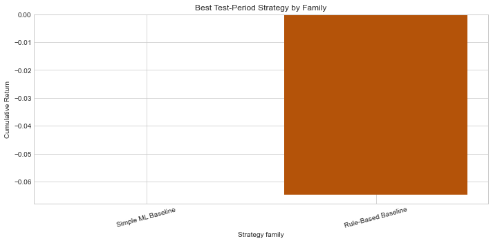

# Robustness Report

## Overview

- Symbol: `BTCUSDT`
- Provider: `binance`
- Venue: `binance`
- Frequency: `1h`
- Evaluation split(s): `['test']`
- Ranking metric: `cumulative_return`
- Best family under the base test-period configuration: `Simple ML Baseline`

## Method Notes

- Cost and holding-window sweeps reuse the same standardized signals and the same backtest engine, so the accounting logic stays identical to the main strategy evaluation.
- Rule-threshold sensitivity is implemented by tightening or relaxing `min_signal_score` in the standardized rule-based signal layer. This measures robustness to stronger or weaker entry confidence, not a full redefinition of the raw heuristic itself.
- Feature ablation retrains only predictive baselines and the deep-learning model, regenerates their signals, and reruns the same backtest logic. Rule-based heuristics are excluded from ablation because they do not consume the engineered feature matrix.
- The comparison tables preserve baseline-specific metadata such as `source_subtype`, `prediction_mode`, `calibration_method`, `signal_threshold`, and `threshold_objective`, so the report stays aligned with the upgraded baseline pipeline rather than collapsing everything into one generic ML bucket.

## Family Comparison

| experiment        | family_name   | family_label        | family_source_name   | scenario_name   |   scenario_order | run_name                           | strategy_name          | source      | source_subtype   | task           |   signal_threshold | signal_threshold_mode   | threshold_objective   | prediction_mode   | calibration_method   | feature_importance_method   | selected_hyperparameters_json                                                   |   trade_count |   active_position_count |   cumulative_return |   annualized_return |   sharpe_ratio |   max_drawdown |   win_rate |   average_trade_return_bps |   average_trade_pnl_usd |   average_holding_hours |   total_turnover_usd |   total_fees_usd |   total_gas_cost_usd |   total_other_friction_usd |   total_funding_pnl_usd |   total_gross_pnl_usd |   total_net_pnl_usd |   final_equity_usd | strategy_detail_label            | scenario_label   |
|:------------------|:--------------|:--------------------|:---------------------|:----------------|-----------------:|:-----------------------------------|:-----------------------|:------------|:-----------------|:---------------|-------------------:|:------------------------|:----------------------|:------------------|:---------------------|:----------------------------|:--------------------------------------------------------------------------------|--------------:|------------------------:|--------------------:|--------------------:|---------------:|---------------:|-----------:|---------------------------:|------------------------:|------------------------:|---------------------:|-----------------:|---------------------:|---------------------------:|------------------------:|----------------------:|--------------------:|-------------------:|:---------------------------------|:-----------------|
| family_comparison | baseline_ml   | Simple ML Baseline  | baseline-ml          | base            |                1 | family_comparison_baseline_ml_base | elastic_net_regression | baseline-ml | baseline_linear  | regression     |                  0 | constant                | avg_signal_return_bps | static            | none                 | permutation_validation      | {"alpha": 1.0, "estimator": "elastic_net", "l1_ratio": 0.2, "random_state": 42} |             0 |                       0 |            0        |            0        |         0      |       0        |          0 |                     0      |                  0      |                   0     |                0     |                0 |                    0 |                          0 |                  0      |                  0    |                0    |           100000   | baseline_linear | static | thr=0 | base             |
| family_comparison | rule_based    | Rule-Based Baseline | rules                | base            |                1 | family_comparison_rule_based_base  | spread_zscore_1p5      | rules       | rule_based       | classification |                  2 | constant                | avg_signal_return_bps | static            | none                 | not_applicable              | {}                                                                              |           200 |                     200 |           -0.064749 |           -0.063419 |       -14.1376 |      -0.064749 |          0 |                   -32.3743 |                -32.3743 |                   1.185 |                8e+06 |             4000 |                  400 |                          0 |                  7.9136 |              -2074.85 |            -6474.85 |            93525.1 | rule_based | static | thr=2      | base             |

## Cost Sensitivity

(no rows)

## Holding-Window Sensitivity

(no rows)

## Rule Threshold Sensitivity

(no rows)

## Feature Ablation

(no rows)

## Figures

